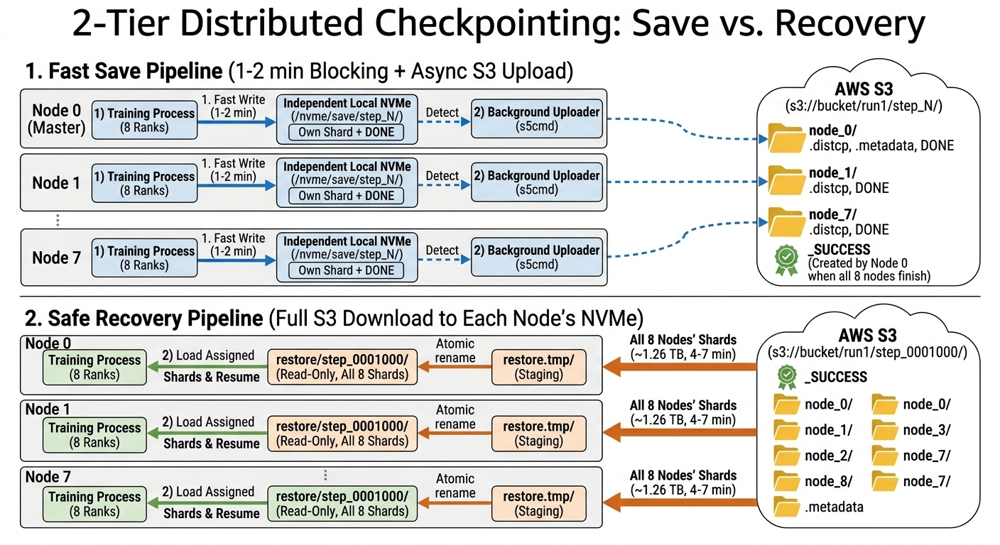
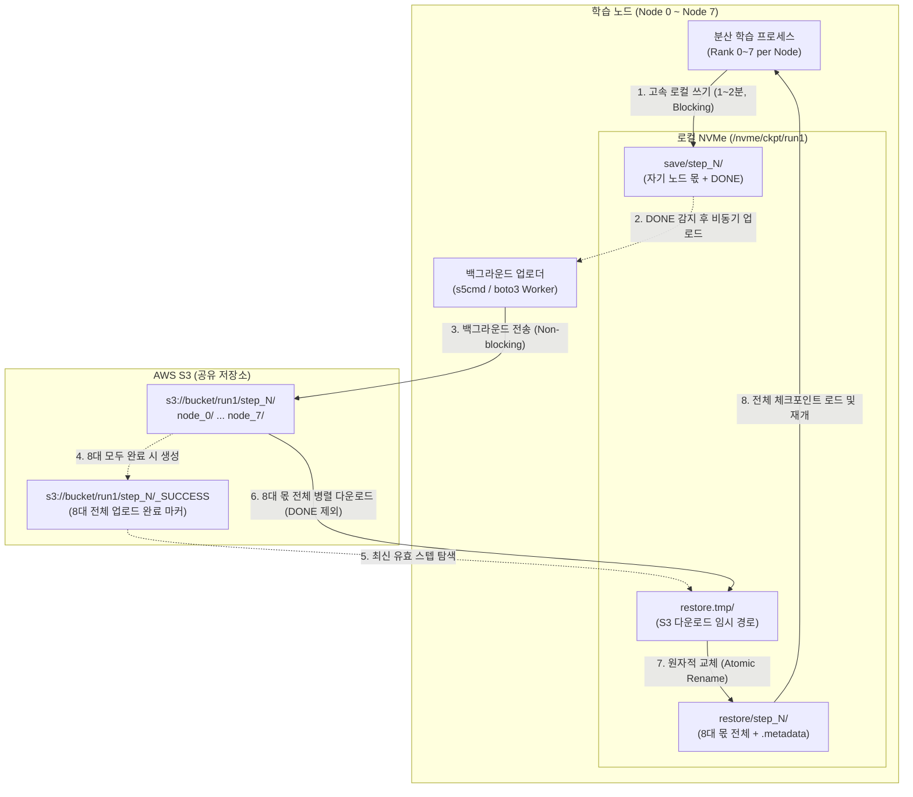
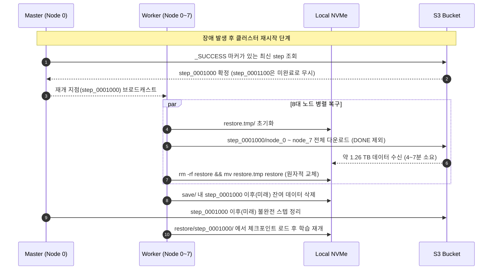

##  I/O 병목 줄이는 2-Tier 체크포인팅(NVMe + S3) 설계 ##

분산 체크포인트(Distributed Checkpoint, Megatron-LM/PyTorch DCP 등) 환경에서 **저장 속도 극대화(로컬 NVMe)**와 **복구 안정성 및 단순성(S3 공유 저장소)**을 동시에 달성하기 위한 2-Tier 체크포인트 파이프라인 설계 및 구현 문서입니다.




"본 분산 체크포인팅 구조는 별도의 공유 파일시스템(Lustre 등) 없이 각 노드의 로컬 NVMe SSD와 Amazon S3만을 활용합니다. 체크포인트 시점이 도래하면 64개 모든 랭크가 각자의 체크포인트 샤드(Shard)를 로컬 NVMe에 우선 기록한 뒤 즉시 다음 스텝 학습을 재개하며, 백그라운드 워커가 비동기로 S3에 파일을 업로드합니다. 이때 Rank 0는 자신의 샤드 파일과 전체 메타데이터(.meta)를 순차적으로 업로드하고, 모든 64개 랭크의 업로드 완료 마커(.done)가 S3에 모인 것을 최종 확인한 뒤 _SUCCESS 파일을 생성함으로써 체크포인트의 원자성(Atomicity)과 데이터 정합성을 보장합니다."


### 1-1. 전체 저장 및 복구 파이프라인 (Mermaid)



### 1-2. 장애 복구 및 재개 시퀀스



---

## 2. 핵심 설계 철학: 로컬 NVMe와 S3의 역할 분담

분산 체크포인트는 여러 Rank가 동시에 써서 저장을 빠르게 하고, 병렬 구성(TP/PP/DP)이 바뀌어도 다시 나눠 읽을 수 있게 하는 기술입니다. 단, 읽을 때는 **모든 노드가 전체 체크포인트 파일을 볼 수 있는 공유 저장소**를 전제로 합니다.

| 단계 | 로컬 NVMe | S3 |
| :--- | :--- | :--- |
| **저장** | **1-2분 안에 써서 학습이 멈추는 시간을 줄임** | **백그라운드에서 업로드** |
| **복구** | **S3에서 받은 파일을 놓는 자리 (Staging)** | **재개 지점을 정하고, 8대 몫 전체를 제공** |

### 설계 트레이드오프 (STAR 관점)
* **성과 (저장 시간 단축):** 각 노드의 로컬 NVMe에 **1~2분** 내에 자기 몫만 기록하고 즉시 학습을 재개합니다. S3 전송은 백그라운드에서 비동기로 처리됩니다.
* **대가 (복구 시간):** 노드 장애나 프로세스 오류 시 S3에서 업로드가 완료된 최신 체크포인트 **전체(노드당 약 1.26 TB)**를 내려받습니다. 초당 3~5 GB 속도로 다운로드 시 **4~7분**이 걸리지만, 장애 빈도가 월 1회 안팎이라면 감당할 수 있으며 프레임워크와 무관하게 **항상 동일한 방식으로 복구할 수 있어 운영이 단순**합니다.

---

## 3. S3 저장 구조 및 병렬 구성 변경(Resharding) 원리

Rank 0으로 데이터를 모아서 한 파일로 쓰지 않고, 각 Rank가 자기 몫을 병렬로 기록합니다.

```text
s3://<bucket>/run1/step_0001000/
  ├── node_0/
  │   ├── __0_0.distcp          # rank 0이 쓴 데이터
  │   ├── ...
  │   ├── .metadata             # 텐서별 전체 크기 및 각 조각의 파일·위치 목록 (rank 0 기록)
  │   ├── common.pt             # Megatron 공통 상태 정보 (rank 0 기록)
  │   ├── metadata.json         # 프레임워크 메타데이터 (rank 0 기록)
  │   └── DONE                  # node_0 업로드 완료 마커
  ├── node_1/
  │   ├── __8_0.distcp
  │   └── DONE
  │   ...
  ├── node_7/
  │   ├── __63_0.distcp
  │   └── DONE
  └── _SUCCESS                  # 8대 노드(node_0 ~ node_7) 모두 업로드 완료 시 생성되는 최종 마커
```

* **Resharding 원리:** `.metadata`에는 텐서마다 전체 크기와 각 조각이 저장된 파일 및 오프셋 위치가 적혀 있습니다. 덕분에 `TP=8, PP=2, DP=4`로 저장한 체크포인트를 노드 수나 병렬화 구성을 바꾼 뒤에도 읽을 수 있습니다. 각 Rank는 새 구성에서 자기가 맡을 부분을 `.metadata`에서 조회해 해당 파일의 특정 위치만 읽습니다.

---

## 4. 로컬 NVMe 디렉토리 격리 구조

쓰기(`save/`)와 읽기(`restore/`) 경로를 엄격히 분리하여 데이터 오염과 업로더 오작동을 방지합니다.

```text
/nvme/ckpt/run1/
  ├── save/                  # 학습이 새 체크포인트를 쓰는 곳 (자기 노드 몫만 존재)
  │   ├── step_0001000/      # 자기 rank 파일 + DONE (해당 노드 쓰기 완료 마커)
  │   └── step_0001100/
  ├── restore/               # 재시작할 때 S3에서 받은 전체 체크포인트 (읽기 전용)
  │   └── step_0001000/      # 8대 몫 전부 + .metadata 같은 공통 파일
  └── restore.tmp/           # 다운로드 중인 임시 폴더 (완료 후 restore/로 원자적 Rename)
```

### 폴더를 분리해야 하는 3가지 이유
1. **업로드 오염 및 `DONE` 의미 보존:** `save/`에는 자기 노드 몫만 있어야 합니다. `DONE`은 *"이 노드의 파일을 다 썼다"*는 뜻이며, 백그라운드 업로더는 이 폴더를 S3의 자기 `node_<번호>/`로 올립니다. 여기에 남의 파일까지 받아 두면 업로더가 타 노드의 파일을 중복 업로드하게 됩니다.
2. **잔여·불완전 파일 격리:** `save/`에는 장애 직전 쓰다 만 파일이나 롤백 전의 미래 스텝 파일이 남아 있을 수 있습니다. 빈 임시 폴더(`restore.tmp/`)에 새로 받으면 기존 파일과 섞일 위험이 없습니다.
3. **읽기/쓰기 생명주기 분리:** 학습은 `save/`에 계속 쓰기 작업을 수행하고, `restore/`는 재개 시 한 번 읽기만 수행하므로 디스크 정리(GC) 규칙을 독립적으로 적용할 수 있습니다.

---

## 5. 자동화 스크립트 예시

대용량 체크포인트(1.26 TB급) 전송 성능을 극대화하기 위해 `aws s3` 대신 병렬 전송에 최적화된 **`s5cmd`**를 기준으로 작성한 실전 스크립트 예시입니다.

### 5-1. 백그라운드 S3 업로더 (`bg_uploader.sh`)
각 노드에서 데몬 형태로 실행되며, `save/` 하위 스텝 폴더에 `DONE` 마커가 생성되면 즉시 S3로 업로드합니다.

```bash
#!/usr/bin/env bash
set -euo pipefail

BUCKET="s3://my-llm-checkpoints/run1"
SAVE_DIR="/nvme/ckpt/run1/save"
NODE_RANK=${NODE_RANK:?NODE_RANK environment variable is required}
TOTAL_NODES=8
KEEP_LOCAL_STEPS=2

echo "[Node ${NODE_RANK}] Starting background S3 uploader..."

while true; do
    # DONE 파일이 생성되었지만 아직 .uploaded 마커가 없는 스텝 탐색
    for done_file in "${SAVE_DIR}"/step_*/DONE; do
        [ -e "$done_file" ] || continue
        step_dir=$(dirname "$done_file")
        step_name=$(basename "$step_dir")

        if [ ! -f "${step_dir}/.uploaded" ]; then
            echo "[Node ${NODE_RANK}] Uploading ${step_name} to S3..."
            
            # 1. 데이터 파일 먼저 업로드 (DONE 제외)
            s5cmd cp --exclude "DONE" --exclude ".*"                 "${step_dir}/" "${BUCKET}/${step_name}/node_${NODE_RANK}/"
            
            # 2. 데이터 전송 완료 후 노드별 DONE 마커 업로드
            s5cmd cp "${done_file}" "${BUCKET}/${step_name}/node_${NODE_RANK}/DONE"
            
            # 3. 로컬 업로드 완료 표시
            touch "${step_dir}/.uploaded"
            echo "[Node ${NODE_RANK}] Upload complete: ${step_name}"

            # 4. Node 0(Master)인 경우 8대 모두 완료되었는지 확인 후 _SUCCESS 생성
            if [ "${NODE_RANK}" -eq 0 ]; then
                done_count=$(s5cmd ls "${BUCKET}/${step_name}/node_*/DONE" 2>/dev/null | wc -l)
                if [ "${done_count}" -eq "${TOTAL_NODES}" ]; then
                    echo "[Node 0] All ${TOTAL_NODES} nodes uploaded ${step_name}. Writing _SUCCESS..."
                    echo "" | s5cmd pipe "${BUCKET}/${step_name}/_SUCCESS"
                fi
            fi
        fi
    done

    # 로컬 NVMe 용량 확보: 업로드 완료된 오래된 스텝 정리 (최근 N개만 유지)
    uploaded_steps=($(find "${SAVE_DIR}" -maxdepth 2 -name ".uploaded" | sort))
    count=${#uploaded_steps[@]}
    if [ "$count" -gt "$KEEP_LOCAL_STEPS" ]; then
        delete_count=$((count - KEEP_LOCAL_STEPS))
        for ((i=0; i<delete_count; i++)); do
            old_step_dir=$(dirname "${uploaded_steps[$i]}")
            echo "[Node ${NODE_RANK}] Cleaning up old local checkpoint: ${old_step_dir}"
            rm -rf "${old_step_dir}"
        done
    fi

    sleep 5
done
```

### 5-2. 재시작 전 복구 및 정합성 정리 스크립트 (`restore_checkpoint.sh`)
학습 런처(`torchrun` 등) 실행 직전에 모든 노드에서 호출되어, 최신 `_SUCCESS` 스텝을 안전하게 `restore/`에 배치합니다.

```bash
#!/usr/bin/env bash
set -euo pipefail

BUCKET="s3://my-llm-checkpoints/run1"
BASE_DIR="/nvme/ckpt/run1"
SAVE_DIR="${BASE_DIR}/save"
RESTORE_DIR="${BASE_DIR}/restore"
RESTORE_TMP="${BASE_DIR}/restore.tmp"
NODE_RANK=${NODE_RANK:?NODE_RANK environment variable is required}
TOTAL_NODES=8

echo "[Node ${NODE_RANK}] Searching for latest valid checkpoint (_SUCCESS)..."

# 1. _SUCCESS 마커가 있는 가장 최신 step 탐색
LATEST_STEP=$(s5cmd ls "${BUCKET}/step_*/_SUCCESS" 2>/dev/null     | awk '{print $NF}'     | sed 's|/[^/]*$||'     | sort     | tail -n 1)

if [ -z "${LATEST_STEP}" ]; then
    echo "[Node ${NODE_RANK}] No valid checkpoint found in S3. Starting from scratch."
    exit 0
fi

echo "[Node ${NODE_RANK}] Found latest valid checkpoint: ${LATEST_STEP}"

# 2. 임시 폴더(restore.tmp) 초기화 및 8대 몫 전체 병렬 다운로드 (DONE 제외)
rm -rf "${RESTORE_TMP}"
mkdir -p "${RESTORE_TMP}/${LATEST_STEP}"

echo "[Node ${NODE_RANK}] Downloading all ${TOTAL_NODES} node shards to ${RESTORE_TMP}..."
for ((i=0; i<TOTAL_NODES; i++)); do
    s5cmd cp --exclude "DONE"         "${BUCKET}/${LATEST_STEP}/node_${i}/*"         "${RESTORE_TMP}/${LATEST_STEP}/"
done

# 3. 원자적 디렉토리 교체 (Atomic Rename)
rm -rf "${RESTORE_DIR}"
mv "${RESTORE_TMP}" "${RESTORE_DIR}"
echo "[Node ${NODE_RANK}] Restore staging complete: ${RESTORE_DIR}/${LATEST_STEP}"

# 4. 로컬 save/ 폴더에서 재개 지점보다 미래의(불완전) 스텝 삭제
for dir in "${SAVE_DIR}"/step_*; do
    [ -d "$dir" ] || continue
    step_name=$(basename "$dir")
    if [[ "${step_name}" > "${LATEST_STEP}" ]]; then
        echo "[Node ${NODE_RANK}] Removing stale future local directory: ${dir}"
        rm -rf "${dir}"
    fi
done

# 5. Master 노드(Node 0)에서 S3 내 재개 지점 이후의 불완전 스텝 정리
if [ "${NODE_RANK}" -eq 0 ]; then
    all_s3_steps=$(s5cmd ls "${BUCKET}/" | awk '/DIR/ {print $2}' | tr -d '/')
    for s3_step in ${all_s3_steps}; do
        if [[ "${s3_step}" > "${LATEST_STEP}" ]]; then
            echo "[Node 0] Cleaning up incomplete future S3 checkpoint: ${BUCKET}/${s3_step}"
            s5cmd rm "${BUCKET}/${s3_step}/*"
        fi
    done
fi

echo "[Node ${NODE_RANK}] Ready to resume training from ${RESTORE_DIR}/${LATEST_STEP}"
```

### 5-3. PyTorch 분산 학습 측 저장 완료 마커 생성 예시 (`save_hook.py`)
학습 코드에서 로컬 NVMe 쓰기가 끝난 직후 `DONE` 파일을 생성하여 백그라운드 업로더를 트리거하는 예시입니다.

```python
import os
import torch
import torch.distributed as dist
import torch.distributed.checkpoint as dcp

def save_checkpoint_to_nvme(model, optimizer, step: int, save_base_dir: str):
    step_dir = os.path.join(save_base_dir, f"step_{step:07d}")
    os.makedirs(step_dir, exist_ok=True)

    # 1. 분산 체크포인트 로컬 NVMe 고속 쓰기 (1~2분 소요)
    state_dict = {
        "model": model.state_dict(),
        "optimizer": optimizer.state_dict(),
        "step": step,
    }
    dcp.save(
        state_dict=state_dict,
        checkpoint_id=step_dir,
    )

    # 2. 같은 노드 내 모든 Rank의 쓰기가 끝날 때까지 동기화
    dist.barrier()

    # 3. 각 노드의 Local Rank 0이 해당 노드 쓰기 완료 마커(DONE) 생성
    local_rank = int(os.environ.get("LOCAL_RANK", 0))
    if local_rank == 0:
        done_tmp = os.path.join(step_dir, ".DONE.tmp")
        done_final = os.path.join(step_dir, "DONE")
        with open(done_tmp, "w") as f:
            f.write("OK
")
        os.replace(done_tmp, done_final)  # 원자적 생성으로 업로더 트리거
```
