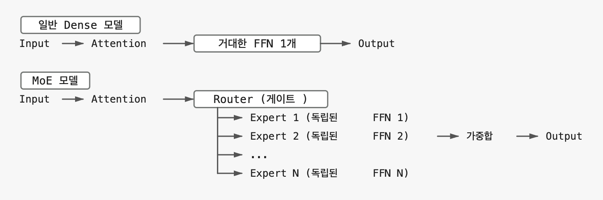

### 1. Gate(Router) 동작 방식 ###

게이트는 거창한 알고리즘이 아니라, 단 하나의 선형 레이어(nn.Linear) + Softmax + Top-K 조합이다.
토큰 벡터(예: 4096차원)를 입력받아 각 Expert(예: 8개)에 대한 "점수(Logit)"를 내고, 점수가 가장 높은 K개(예: 2개)만 뽑아서 그 점수를 가중치로 곱해주는 코드이다.

```
import torch
import torch.nn as nn
import torch.nn.functional as F


class FFN(nn.Module):
    def __init__(self, hidden_dim, intermediate_dim):
        super().__init__()
        # 1. 차원을 넓히는 레이어 2개 (hidden_dim -> intermediate_dim)
        self.gate_proj = nn.Linear(hidden_dim, intermediate_dim, bias=False)
        self.up_proj   = nn.Linear(hidden_dim, intermediate_dim, bias=False)
        
        # 2. 다시 원래 차원으로 줄이는 레이어 1개 (intermediate_dim -> hidden_dim)
        self.down_proj = nn.Linear(intermediate_dim, hidden_dim, bias=False)

    def forward(self, x):
        # SwiGLU 연산: gate_proj에 SiLU 활성화 함수를 적용한 뒤 up_proj 결과와 곱하고, down_proj로 축소
        return self.down_proj(F.silu(self.gate_proj(x)) * self.up_proj(x))


class MoELayer(nn.Module):
    def __init__(self, hidden_dim, num_experts, top_k=2):
        super().__init__()
        self.num_experts = num_experts
        self.top_k = top_k
        
        # 1. 게이트(Router): 토큰 차원(hidden_dim) -> Expert 개수(num_experts)로 투영하는 단순 행렬 곱
        self.gate = nn.Linear(hidden_dim, num_experts, bias=False)
        
        # 2. 독립된 Expert FFN 리스트
        self.experts = nn.ModuleList([FFN(hidden_dim) for _ in range(num_experts)])

    def forward(self, x):
        # x shape: (토큰 수, hidden_dim)
        
        # [Step 1] 각 토큰별로 모든 Expert에 대한 점수 계산 -> shape: (토큰 수, num_experts)
        logits = self.gate(x)
        
        # [Step 2] 확률로 변환 후 가장 높은 top_k개 선택
        probs = F.softmax(logits, dim=-1)
        weights, selected_experts = torch.topk(probs, self.top_k, dim=-1)
        
        # 선택된 K개 가중치의 합이 1이 되도록 재정규화
        weights = weights / weights.sum(dim=-1, keepdim=True)
        
        # [Step 3] 선택된 Expert만 실행해서 가중합 계산
        output = torch.zeros_like(x)
        for i, expert in enumerate(self.experts):
            # 현재 i번 Expert가 선택된 토큰 위치(인덱스)만 찾아냄
            token_idx, k_idx = torch.where(selected_experts == i)
            if len(token_idx) > 0:
                # 해당 토큰들만 i번 Expert에 통과시키고 가중치를 곱해 더함
                expert_out = expert(x[token_idx])
                output[token_idx] += weights[token_idx, k_idx].unsqueeze(-1) * expert_out
                
        return output
```
